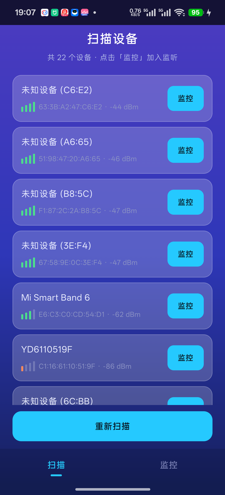
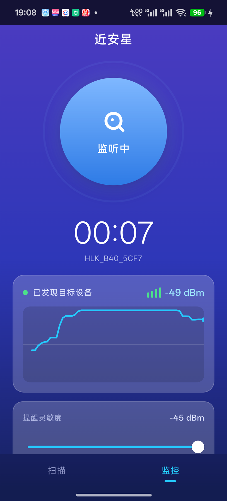

<p align="center">
  
</p>

<h1 align="center">近安星 Nestar</h1>

<p align="center">
  <b>脚步临近，平安知讯。</b><br/>
  基于 BLE 蓝牙的防丢 App —— 寻物 · 接娃
</p>

<p align="center">
  
  
  
</p>

手机端扫描附近 BLE 设备，把关注的设备加入「监控」，当目标进入设定信号范围时持续震动 + 通知提醒；适用于找钥匙/书包/接娃等场景。

---

## 截图

<p align="center">
  
  &nbsp;&nbsp;
  
</p>
<p align="center"><i>左：扫描附近设备（按信号强弱排序） · 右：实时信号波形监控</i></p>

---

## 功能

- **扫描附近 BLE 设备**：列出周边设备（名称 / MAC / 信号强度），按信号强弱排序，带 4 格信号图标。
- **添加监控目标并记忆**：把某设备加入监控，重启 / 杀进程 / 冷启动后仍自动恢复。
- **寻娃 / 寻物提醒**：点「开始搜索」后实时追踪信号强度与波形：
  - 信号达阈值 → 🔴 红色「停止提醒」，持续震动 + 通知；
  - 信号未达阈值 → 🔵 蓝色「监听中」（不震动）；
  - 目标消失 → 🟠 橙色「重新搜索」。
- **无极灵敏度调节**：连续滑杆设定提醒阈值（-100 ~ -45 dBm，-100 视为「不限」），带 5dB 迟滞回差防抖。
- **实时信号波形图**：500ms/点，约 30 秒滚动窗口。
- **状态记忆**：监控目标 / 监听状态 / 灵敏度持久化。

## 权限（最小化）

Android 12+ 仅申请：

| 权限 | 用途 |
|---|---|
| `BLUETOOTH_SCAN`（neverForLocation） | 扫描 BLE 设备 |
| `VIBRATE` | 到达提醒震动 |
| `POST_NOTIFICATIONS`（13+） | 提醒通知 |

低版本（≤ Android 11）额外使用 `BLUETOOTH`、`BLUETOOTH_ADMIN`、`ACCESS_FINE_LOCATION`（旧系统 BLE 扫描要求）。

本 App **无网络权限**，数据不出本机。

## 构建

需要 JDK 17 + Android SDK（compileSdk 34）。

```bash
./gradlew :app:assembleDebug     # 调试包
./gradlew :app:assembleRelease   # 发布包（签名见下）
```

签名（可选）——项目根目录新建 `keystore.properties`：

```properties
storeFile=/absolute/path/release.keystore
storePassword=******
keyAlias=nestar
keyPassword=******
```

未提供时 release 走未签名构建。

## 技术栈

- Kotlin + Jetpack Compose (Material3)
- Android BLE（BluetoothLeScanner）
- 最低 Android 6.0（API 23），目标 API 34

## 许可证

[MIT](LICENSE) © 2026 JobinBai
